  

  
  
  
  

<h3 align="center">🕹️ Tu progreso personal, gamificado.</h3>

  Una app web para construir hábitos, organizar tu día, estudiar mejor y aprender inglés — 
  con XP, niveles, rachas, 130 medallas y hasta castigos si te relajas demasiado.

  

  👉 <b><a href="https://habits.proyecto.lol/">https://habits.proyecto.lol/</a></b>

 

## 📖 ¿De qué se trata?

**DY Habit Tracker & English** es un sistema personal de disciplina con estilo de videojuego.
Cada hábito que cumples te da experiencia (**XP**), los días seguidos forman **rachas**, cada
logro desbloquea **medallas** y dejar de hacer algo tiene **consecuencias**: pierdes XP o giras
la ruleta de castigos 🎡.

Pero no es solo un *habit tracker*. En el mismo lugar organizas tus **tareas** en un calendario
con recordatorios por correo, armas tu **Vision Board** con tus metas, estudias con **tableros
Kanban** y la técnica de explicar temas en voz alta, y practicas **inglés** con tu propio
vocabulario, *shadowing* y juegos.

> En corto: un solo lugar para tus hábitos, tus pendientes, tus metas y tu estudio, donde
> avanzar se siente como subir de nivel.

**Pruébala en línea:** [habits.proyecto.lol](https://habits.proyecto.lol/). Crea tu cuenta
gratis desde la pantalla de inicio y, si quieres, instálala en tu celular desde el navegador.

 

## 🧩 Módulos

### 🔥 Hábitos y disciplina

| | Módulo | ¿Qué hace? |
|:---:|---|---|
| 🔥 | **Gestión de Hábitos** | Crea hábitos con categoría, frecuencia y **días de la semana en que tocan**, y llévalos entre `Activo`, `Pausado` y `Completado`. |
| 📅 | **Plan del mes** | Al empezar cada mes eliges con qué hábitos te comprometes. Una vez confirmado, el plan queda fijo hasta el mes siguiente: no vale borrar lo difícil a mitad de camino. |
| ✅ | **Check diario** | Marca en un toque lo que cumpliste hoy, con cuenta regresiva hasta el reinicio. Lo que no toca hoy no aparece ni cuenta como pendiente. |
| ♻️ | **Recuperar día** | ¿Fallaste un día? Haz ese hábito **3 veces en sus días libres** del mes y recuperas el día perdido. |
| 🎮 | **Mi Nivel Personal** | XP, rachas, 10 niveles y penalizaciones por los días sin actividad. |
| 🏆 | **Medallas** | **130 medallas** que se ganan solas a partir de tu actividad. |
| 📊 | **Estadísticas** | Cumplimiento de cada hábito por mes, comparación entre meses y un calendario de lo que hiciste cada día. |
| 🎡 | **Castigos + Ruleta** | Defines tus propios castigos y una ruleta los sortea cuando toca. |
| 💬 | **Motivación** | Una frase de anime distinta cada día y un reto diario. |

### 📝 Organización

| | Módulo | ¿Qué hace? |
|:---:|---|---|
| 📝 | **Tareas del Día** | Pendientes sueltos que no son hábitos. Puedes ponerlos para hoy, para mañana o para cualquier día en un **calendario grande** que muestra cuántas tareas tiene cada día. Las tareas se pueden **editar**. |
| 🔔 | **Recordatorios por correo** | Ponle una hora a una tarea y, si a esa hora sigue pendiente, te llega un correo. También puedes recibir a la hora que elijas un resumen de los hábitos que te faltan. |
| 🌠 | **Vision Board** | Un collage con las fotos de tus metas, por categoría (personal, salud, estudio, dinero, viajes, trabajo), con fecha objetivo y sello de **¡Lograda!**. Se descarga como **póster tamaño A4** listo para imprimir y pegar en la pared. |

### 📚 Estudio

| | Módulo | ¿Qué hace? |
|:---:|---|---|
| 🗂️ | **Métodos de Estudio** | Tus métodos (Pomodoro, Feynman…), cada uno con su **tablero Kanban** de arrastrar y soltar y la opción de subir tus apuntes al terminar un tema. |
| 🎲 | **Temas Aleatorios** | Anotas los temas que estás estudiando, una ruleta elige uno y lo **explicas en voz alta** contra el reloj. Luego calificas qué tan bien te salió. |

### 🌐 Inglés

| | Módulo | ¿Qué hace? |
|:---:|---|---|
| 📖 | **Vocabulario** | Tus propias palabras, con significado y ejemplos. Las repasas calificando qué tan difícil fue cada una y subes de rango a medida que tu vocabulario crece. |
| 🎧 | **Shadowing** | Sesiones cronometradas para practicar pronunciación, con historial y calendario. |
| 🧩 | **Juegos** | Unir palabras con su significado y sopa de letras, armados con **tu** vocabulario. |

### 👤 Cuenta y administración

| | Módulo | ¿Qué hace? |
|:---:|---|---|
| 👤 | **Mi Perfil** | Foto, usuario, contraseña y correo para los recordatorios. |
| 🔑 | **Recuperar contraseña** | Si la olvidas, te llega un código al correo para crear una nueva. |
| 🛡️ | **Panel de administración** | Una cuenta especial que no usa la app: ve los usuarios registrados con sus estadísticas, puede bloquearlos o eliminarlos y tiene su propio perfil. El panel es sobrio, sin animaciones. |

 

## 🎮 Sistema de niveles

El nivel depende de **dos** cosas a la vez: la XP que juntas **y** la cantidad de hábitos
distintos que has creado. No basta con acumular XP: también hay que construir hábitos nuevos.

| Nivel | Título | XP requerida |
|:---:|---|---:|
| 1 | 🌱 Novato | 0 |
| 2 | 📗 Aprendiz | 500 |
| 3 | 🔵 Constante | 1,500 |
| 4 | 🟣 Disciplinado | 3,000 |
| 5 | 🎯 Enfocado | 5,000 |
| 6 | 🛡️ Resiliente | 7,500 |
| 7 | ♟️ Estratega | 10,500 |
| 8 | 🥋 Maestro de Hábitos | 14,000 |
| 9 | 🧙 Mentor de Disciplina | 18,000 |
| 10 | 👑 Leyenda del Hábito | 22,500 |

- **+15 XP** por cada hábito marcado como hecho.
- **+20 XP** de bono cada vez que la racha llega a un múltiplo de 7 días.
- **−20 XP** por cada día sin actividad **en el que te tocaba algún hábito**.

### 🛋️ Días de descanso

Cada hábito tiene sus días de la semana (por ejemplo, Ejercicio solo lunes, miércoles y
viernes). Los días que no le tocan son de descanso: no aparece en el check, no baja tu
porcentaje, **no rompe la racha y no resta XP**.

 

## 🏆 Medallas

Se ganan solas a partir de tu actividad (no hay que reclamarlas) y se muestran como tarjetas
con progreso, rareza y una frase motivadora.

| Grupo | Se abre en | Medallas | Ejemplos |
|---|---|:---:|---|
| Básicas | Nivel 1 | 30 | Primer hábito, racha de 7 días, primera palabra en inglés |
| Rango I · Despertar | Nivel 2 | 20 | 150 hábitos, racha de 21 días, 7 días perfectos |
| Rango II · Forja | Nivel 4 | 20 | 400 hábitos, racha de 45 días, un mes con 80% o más |
| Rango III · Ascenso | Nivel 6 | 20 | 750 hábitos, racha de 75 días, 60 días perfectos |
| Rango IV · Élite | Nivel 8 | 20 | 1.250 hábitos, racha de 120 días |
| Rango V · Leyenda | Nivel 10 | 20 | 2.000 hábitos, **racha de un año**, 30.000 XP |

Las medallas de rango piden cumplir la meta **y** haber llegado al nivel del rango.

 

## 🎨 Cómo se ve y se siente

- **Tema oscuro** con hojas que caen y un resplandor suave que sigue al mouse.
- **Cinco personajes de anime** en el inicio de sesión: cada vez sale uno distinto y toda la
  app toma sus colores.
- **Inglés con su propio color** (azul), para que se sienta como un espacio aparte.
- **Correos con el mismo diseño** de la app, con el personaje y tus pendientes.
- **Se instala en el celular** como una app más (Android o iPhone), desde el navegador.

 

## 🔒 Privacidad y seguridad

- Cada persona solo ve y modifica sus propios datos, apuntes y fotos.
- Las contraseñas se guardan cifradas, deben ser seguras y cambiarlas siempre pide la actual.
- Varios intentos fallidos de inicio de sesión bloquean el acceso por un rato.
- Las imágenes que se suben se revisan, y las fotos de perfil se limpian de datos como la ubicación GPS.
- Borrar la cuenta borra de verdad todo lo que la persona guardó.
- El administrador solo ve números y correos ocultos (`a***na@correo.com`), nunca lo que cada
  persona escribió en sus hábitos, tareas o metas.

 

## 🛠️ Hecho con

  
  
  
  
  
  
  
  
  
  
  
  

 

## 📄 Licencia

Este proyecto se distribuye bajo la licencia **MIT**: puedes usarlo, copiarlo y modificarlo libremente, siempre que mantengas el aviso de copyright. Consulta el archivo [LICENSE](LICENSE) para ver el texto completo.

 

  Hecho con 🖤 y mucha disciplina propia.

